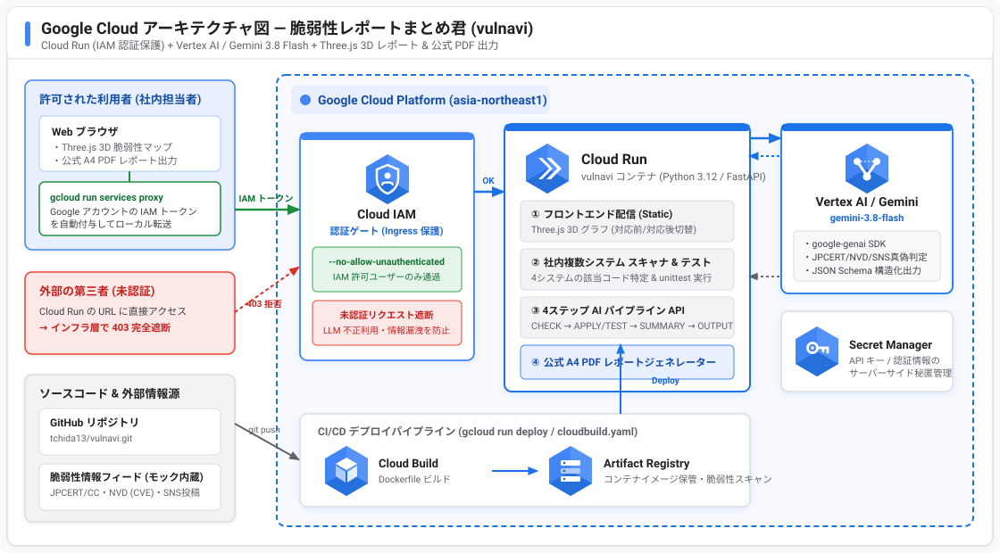

# 🛡️ VulsNavi

> **JPCERT/CC・NVD・SNS(X等)の脆弱性情報を照合し、4ステップ（`CHECK` → `APPLY/TEST` → `SUMMARY` → `OUTPUT`）で社内複数システムの影響箇所特定・パッチ適用＆テスト検証・上司/同僚向けレポート生成を自動化する AI セキュリティプラットフォーム**

---

## 🎯 30秒エレベーターピッチ（解決する課題と価値）

日々大量に流れる脆弱性アラートや SNS 上のゼロデイ騒動に対し、セキュリティ担当者・開発現場は以下の4つの苦痛を抱えています：
1. **情報の真偽が不明**：SNS で拡散されている脆弱性が本当に正しいのか、自社に関係あるのか分からない。
2. **社内システムのどこが影響を受けるか不明**：複数ある社内システムのどのファイルの何行目で使われているのか、あるいは「`requirements.txt` にあるだけで実は未使用」なのか即座に判別できない。
3. **パッチ適用・テスト・代替検討の負荷**：修正パッチを当てて既存機能が壊れないかのテスト検証や、より安全な代替ライブラリの選定に時間がかかる。
4. **上司・他部署への報告資料作成が大変**：非エンジニアの上長や稟議提出向けに、対応前後の状況を一目で説明できる3D可視化と「A4公式報告書（PDF）」を作るのに毎回何時間も費やしている。

**「VulsNavi」** は、**Google Cloud (`Cloud Run` + `Vertex AI / Gemini 3.8 Flash`)** 上で **「8人の専門代理人」** の役割を4ステップで一気通貫実行し、**Three.js 3D インタラクティブ脆弱性マップ（対応前⇔対応後トグル付）** と **社内稟議・監査提出用の白背景 A4 公式 PDF レポート** をワンクリックで生成します。

---

## 🧭 旗印シート「4ステップ」× アイデアシート「8人の代理人」完全対応表

| 旗印シートの4ステップ | アイデアシートの「8人の代理人」の役割 | `VulsNavi` での実装内容 |
| :--- | :--- | :--- |
| **Step 1: CHECK**<br>情報元・内容の正しさ確認 | ① SNSなどで最新の情報を収集する人 | JPCERT/CC・NVD・SNS(X等)のアラートを照合し、`gemini-3.8-flash`（`google-genai` SDK）が真偽（**確定脆弱性**／**SNSデマ**／**対策済**）とCVSS深刻度を精査 |
| **Step 2: APPLY / TEST**<br>システムの対応箇所確認・テスト | ③ システムやリポジトリのバージョン・ライブラリを収集する人<br>⑤ 対応する修正パッチを取得・適用する人<br>⑥ 使っていないライブラリを指摘してくれる人<br>⑦ テストする人（攻撃検証含む）<br>⑧ 代替ライブラリなどを提案してくれる人 | 社内4システムの依存関係と実コードを走査し、**ファイルパス・行番号・コード抜粋**を特定。**未使用ライブラリ（`SYS-01` の `pyyaml`）を検出**して削除提案し、修正パッチ適用＆**`unittest` 自動実行**＋**代替ライブラリ（`tomllib`/`httpx`/`fetch`等）提案**を実施 |
| **Step 3: SUMMARY**<br>実施した対応内容をまとめ | ④ 上司や同僚に説明してくれる人 | 非エンジニアの上司にも30秒で伝わる**「3行エグゼクティブサマリー」**と**「社内4システム横断影響マトリクス（対応前⇔対応後）」**・今後の恒久対策を生成 |
| **Step 4: OUTPUT**<br>PDF / HTML のレポートに出力 | ② 対応した内容をレポートにまとめる人 | **Three.js 3D インタラクティブ HTML ダッシュボード**（対応前/対応後トグル・ノード別インスペクタ付）と、社内稟議・監査提出用の**白背景 A4 公式 PDF レポート**を出力 |

---

## ☁️ Google Cloud セキュアアーキテクチャ（公式アイコン準拠）



### セキュリティ設計のポイント（OAuth 設定不要・インフラ層での完全保護）
- **`--no-allow-unauthenticated` による Cloud IAM 認証ゲート**：
  Cloud Run サービスは未認証アクセスを遮断してデプロイします。外部の第三者が URL に直接アクセスしても Google Cloud のインフラ層で `403 Forbidden` となり、社内システム構成情報の漏洩や Gemini API の不正利用（課金タダ乗り）を確実に防ぎます。
- **`gcloud run services proxy` によるゼロコンフィグ認証アクセス**：
  面倒な OAuth クライアント ID や承認済みリダイレクト URI の設定は一切不要です。許可された利用者は手元で `gcloud run services proxy vulnavi` を実行するだけで、自身の Google アカウントの IAM トークンが自動付与され、`http://localhost:8080` から安全に全機能を利用できます。
- **Google GenAI SDK (`google-genai`) & `gemini-3.8-flash` Structured Outputs**：
  最新の `from google import genai` (`client.interactions.create`) と JSON Schema 構造化出力を使用し、Vertex AI (ADC) または `GEMINI_API_KEY` の双方に対応しています（オフライン環境でも確実に動作する決定論的フォールバックエンジン内蔵）。

---

## 🚀 クイックスタート（ローカル実行手順）

### 1. 依存パッケージのインストール
```bash
python3 -m venv .venv
source .venv/bin/activate
pip install -r requirements.txt
```

### 2. サーバーの起動
```bash
# Gemini API キーを使用する場合（未設定でも内蔵フォールバックエンジンでフル機能が動作します）
export GEMINI_API_KEY="your-api-key"

uvicorn main:app --host 0.0.0.0 --port 8080 --reload
```
ブラウザで **`http://localhost:8080`** を開くと、Three.js 3D サイバーパンクダッシュボードが起動します。

- **公式 A4 レポート（HTML 印刷モード）**: `http://localhost:8080/report/official`
- **公式 A4 レポート（PDF 直接ダウンロード）**: `http://localhost:8080/api/report/pdf`

### 3. 自動テスト（Jidoka 品質ゲート）の実行
```bash
python3 -m unittest discover -s tests -v
```

---

## ☁️ Google Cloud Run へのデプロイ手順

```bash
chmod +x deploy.sh
PROJECT_ID="your-gcp-project-id" REGION="asia-northeast1" ./deploy.sh
```
スクリプトが自動的に以下を実行します：
1. `--no-allow-unauthenticated` 付きで Cloud Run (`asia-northeast1`) へコンテナをビルド＆デプロイ
2. `gcloud run services proxy vulnavi --port 8080` を起動し、`http://localhost:8080` で安全にブラウザ接続を開始

---

## 📂 ディレクトリ構成

```text
vulnavi/
├── Dockerfile                    # Cloud Run 用コンテナ定義 (python:3.12-slim, 非root実行, PORT=8080)
├── cloudbuild.yaml               # Cloud Build CI/CD (unittest 実行 → Build → Cloud Run IAM保護デプロイ)
├── deploy.sh                     # Cloud Run デプロイ & gcloud proxy ワンコマンド実行スクリプト
├── requirements.txt              # FastAPI, Uvicorn, google-genai, Pydantic, reportlab, httpx
├── main.py                       # FastAPI サーバー (4ステップAPI/SSE, セキュリティヘッダー, 公式PDF配信)
├── docs/
│   ├── gcp_architecture.svg      # Google Cloud 公式アイコン準拠アーキテクチャ図
│   └── implementation_plan.md    # 実装計画書
├── src/
│   ├── schemas.py                # 4ステップ構造化スキーマ (Pydantic / Gemini JSON Schema)
│   ├── scanner.py                # 社内4システムの実コード走査・未使用検出・unittest実行・3Dグラフ構築
│   ├── llm_engine.py             # google-genai SDK (gemini-3.8-flash) 推論エンジン + フォールバック
│   └── reporter.py               # 白背景 A4 公式ビジネス文書 HTML / PDF ジェネレーター
├── static/
│   ├── index.html                # Three.js 3D ビューポート + 4ステップ進行バー + インスペクタ UI
│   ├── css/style.css             # サイバーパンク HUD スタイル (ダークテーマ & 高コントラスト)
│   └── js/
│       ├── graph3d.js            # Three.js 3D ノードグラフ (2D追従ラベル・対応前後切替・レーザー演出なし)
│       └── app.js                # SSE 4ステップ制御・カスタムアラート検証・公式PDF出力連携
├── sample_inputs/
│   ├── systems/                  # 社内保有の4システム (実コード + requirements/package.json + unittest)
│   │   ├── corporate_systems.json
│   │   ├── order_pay_api/        # SYS-01: 決済API (jinja2, requests 使用中 / pyyaml 未使用)
│   │   ├── customer_portal/      # SYS-02: 顧客ポータル (jinja2, axios 使用中 / lodash 対策済)
│   │   ├── nightly_batch/        # SYS-03: 夜間集計バッチ (pyyaml, requests 使用中)
│   │   └── admin_console/        # SYS-04: 社内管理コンソール (全ライブラリ最新パッチ適用済)
│   └── vuln_alerts/
│       └── collected_alerts.json # JPCERT/CC・NVD の確定情報4件 + SNSデマ1件 + SNS対策済1件
└── tests/
    └── test_vulnavi.py           # 全4ステップ・API・PDF出力・モックシステムunittestの自動テストスイート
```
