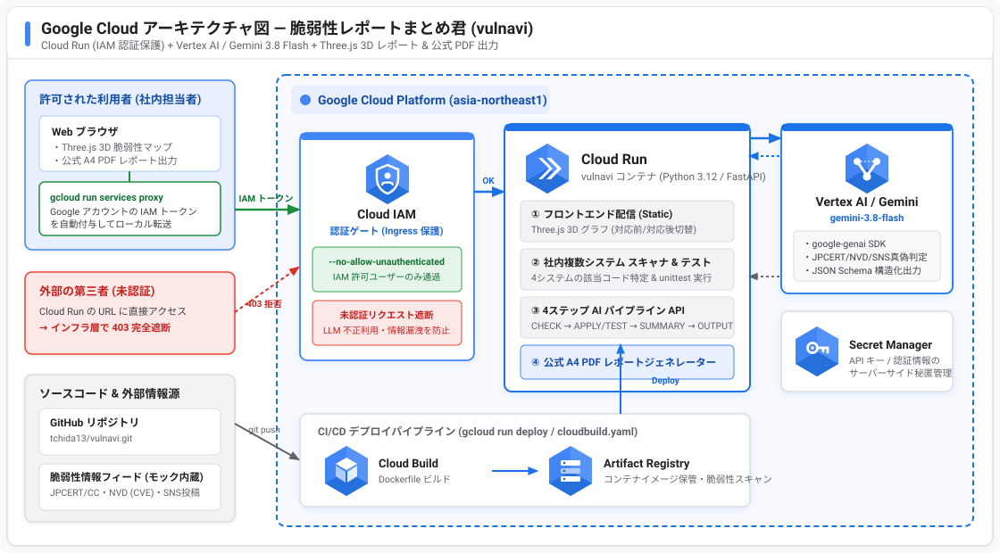

# 脆弱性レポートまとめ君 (`vulnavi`) 最終実装計画（レビュー反映版）

## Goal Description

アイデアシート・旗印シートおよび `/grill-me` で決定した仕様に基づき、Google Cloud (Cloud Run) 上で動作する「**脆弱性レポートまとめ君 (`vulnavi`)**」を構築します。

### アイデアシート「8人の代理人」と4ステップの完全対応表

| 旗印シートの4ステップ | アイデアシートの「8人の代理人」の役割 | `vulnavi` での実装内容 |
| :--- | :--- | :--- |
| **Step 1: CHECK**<br>情報元・内容の正しさ確認 | ① SNSなどで最新の情報を収集する人 | JPCERT/CC・NVD・SNS(X等)のアラートを収集し、`gemini-3.8-flash` が真偽（確定／デマ／対象外）と深刻度を精査 |
| **Step 2: APPLY / TEST**<br>システムの対応箇所確認・テスト | ③ システムやリポジトリのバージョン・ライブラリを収集する人<br>⑤ 対応する修正パッチを取得・適用する人<br>⑥ 使っていないライブラリを指摘してくれる人<br>⑦ テストする人（攻撃検証含む）<br>⑧ 代替ライブラリなどを提案してくれる人 | 社内4システムの依存関係と実コードを走査し、該当ファイル・行番号を特定。未使用ライブラリを検出し、パッチ適用シミュレーション＆`unittest`自動実行＋代替ライブラリ提案を実施 |
| **Step 3: SUMMARY**<br>実施した対応内容をまとめ | ④ 上司や同僚に説明してくれる人 | 非エンジニアの上司にも伝わる「3行エグゼクティブサマリー」と「社内他システムへの横断影響マトリクス」「今後の対応方針」を生成 |
| **Step 4: OUTPUT**<br>PDF / HTML のレポートに出力 | ② 対応した内容をレポートにまとめる人 | **Three.js 3D インタラクティブ HTML レポート**（対応前/対応後トグル付）と、稟議・報告用の**白背景 A4 オフィシャル PDF レポート**を出力 |

---

## Google Cloud セキュアアーキテクチャ（公式アイコン図）



---

## Plan Review & Technical Decisions（計画レビューによる改善点）

> [!IMPORTANT]
> 実装計画のレビューにより、以下の技術的リスクを事前に解消する設計としています。
> 1. **Cloud Run での軽量動作と高品質 A4 PDF 出力の両立**：
>    - Cloud Run コンテナに巨大な Chromium を同梱せずコンテナを軽量（約150MB）に保ちます。
>    - 公式 PDF 出力は、①ブラウザから1クリックで白背景・A4縦の専用印刷レイアウトを呼び出す `/report/official?print=1` モードと、②サーバーサイドで直接 PDF バイナリを生成・返却する `/api/report/pdf`（ReportLab / WeasyPrint 相当の軽量生成＋ローカル Chrome 検出時はヘッドレス印刷も利用可能）のデュアル対応にします。
> 2. **4ステップのリアルな進行表示とレスポンス速度の両立**：
>    - Step 2 のコード走査と `unittest` 実行は Python バックエンドが実ファイルに対して行い、その正確なエビデンス（行番号・テスト実行ログ）を `gemini-3.8-flash`（`google-genai` SDK）に渡して JSON Schema 構造化出力させます。
>    - フロントエンドへは SSE（Server-Sent Events）で Step 1 → Step 2 → Step 3 → Step 4 の進捗と推論ログをリアルタイムにストリーム配信します。
> 3. **Three.js 3D ノードの視認性向上（ラベル追従表示）**：
>    - 3D 空間上の各ノードにシステム名・ライブラリ名・状態バッジの 2D フローティングラベルを追従表示させ、マウス操作でぐりぐり動かしても「どのシステム・どのライブラリか」が一目で分かるようにします。

---

## Proposed Changes

ファイル構成は以下の通りです。

```text
vulnavi/
├── .gitignore                    # .DS_Store, __pycache__, .env, venv, reports/ 等を除外
├── Dockerfile                    # Google Cloud Run 用コンテナ定義 (非root・PORT=8080)
├── cloudbuild.yaml               # Google Cloud Build / Cloud Run デプロイ定義 (--no-allow-unauthenticated)
├── deploy.sh                     # Cloud Run セキュアデプロイ & プロキシ接続スクリプト
├── requirements.txt              # FastAPI, Uvicorn, google-genai, Pydantic, reportlab
├── README.md                     # アーキテクチャ図・30秒ピッチ・ローカル実行・Cloud Run 手順
├── docs/
│   └── gcp_architecture.svg      # Google Cloud 公式アイコン準拠アーキテクチャ図
├── main.py                       # FastAPI サーバー (セキュリティヘッダー・4ステップSSE/API・静的配信)
├── src/
│   ├── __init__.py
│   ├── schemas.py                # 4ステップ構造化スキーマ (Pydantic / Gemini Structured Output対応)
│   ├── scanner.py                # 社内4システムのコード走査・パッチ適用＆unittest検証エンジン
│   ├── llm_engine.py             # google-genai SDK (gemini-3.8-flash) 推論エンジン + フォールバック
│   └── reporter.py               # オフィシャル白背景 A4 HTML / PDF レポートジェネレーター
├── static/
│   ├── index.html                # サイバーパンクUI + Three.js 3Dビューア + サイドインスペクタ
│   ├── css/
│   │   └── style.css             # サイバーパンクHUDスタイル & レスポンシブレイアウト
│   └── js/
│       ├── graph3d.js            # Three.js 立体ノードグラフ (ラベル追従・クリック連動・Before/After切替)
│       └── app.js                # 4ステップリアルタイム進行制御・サイドパネル・公式PDF出力制御
├── sample_inputs/
│   ├── systems/                  # 社内保有の4システム（モック構成＆実コード＆テスト）
│   │   ├── corporate_systems.json # 社内4システムの構成・依存ライブラリ・オーナー定義
│   │   ├── order_pay_api/        # システム1: 決済API (app.py, requirements.txt, test_app.py)
│   │   ├── customer_portal/      # システム2: 顧客ポータル (portal.py, package.json, test_portal.py)
│   │   └── nightly_batch/        # システム3: 夜間集計バッチ (batch.py, requirements.txt, test_batch.py)
│   └── vuln_alerts/              # 収集された脆弱性情報（JPCERT / NVD / SNS）
│       └── collected_alerts.json # 公的機関情報＋SNSの噂が混在したインプットデータ
└── tests/
    └── test_vulnavi.py           # バックエンドAPI・スキャナ・LLMスキーマ・PDF生成の自動テスト
```

---

### 1. モックデータのクリーンアップと構築 (`sample_inputs/`)

#### [DELETE] `sample_inputs/target_project/`
- 初期計画時に作成した単一システム用の仮ディレクトリを削除し、`sample_inputs/systems/` の複数システム構成に統一します。

#### [NEW] [corporate_systems.json](file:///Users/tchida/Desktop/AntigravityDeepDive/vulnavi/sample_inputs/systems/corporate_systems.json) ＆ 社内4システムの実コード・テスト
1. **`SYS-01` 決済・注文管理API (`order_pay_api`)**：
   - 使用ライブラリ：`jinja2==3.1.2`（`app.py` 18行目の領収書生成で使用中 → パッチ対象）、`requests==2.31.0`（`app.py` 34行目の決済GW通信で使用中 → パッチ対象）、`pyyaml==5.4.0`（`requirements.txt` に記載があるがコード内で**一切未使用** → 削除提案）
2. **`SYS-02` 顧客マイページポータル (`customer_portal`)**：
   - 使用ライブラリ：`jinja2==3.1.2`（`portal.py` 14行目のマイページ描画で使用中 → パッチ対象）、`axios==1.5.0`（フロント通信で使用中 → `1.6.0` へ更新対象）、`lodash==4.17.21`（修正済み最新バージョンのため安全）
3. **`SYS-03` 夜間売上集計バッチ (`nightly_batch`)**：
   - 使用ライブラリ：`pyyaml==5.4.0`（`batch.py` 12行目で危険な `yaml.load()` を使用中 → `yaml.safe_load()` へのコード修正＆`6.0.1` 更新＋代替として `tomllib` / `json` への移行提案）、`requests==2.31.0`（社内API通信で使用中 → 更新対象）
4. **`SYS-04` 社内管理コンソール (`admin_console`)**：
   - 使用ライブラリ：`jinja2==3.1.4`, `requests==2.32.2`（定期メンテナンスで最新パッチ適用済み・対応不要）

#### [NEW] [collected_alerts.json](file:///Users/tchida/Desktop/AntigravityDeepDive/vulnavi/sample_inputs/vuln_alerts/collected_alerts.json)
- **JPCERT/CC & NVD の公的情報（3件）** と **SNS（X等）の投稿（2件：うち1件は完全なデマ、1件は自社では対策済みの旧情報）** の計5件を用意し、画面上から自由に追加・編集も可能にします。

---

### 2. バックエンド＆LLMエンジン (`main.py`, `src/`)

#### [NEW] [schemas.py](file:///Users/tchida/Desktop/AntigravityDeepDive/vulnavi/src/schemas.py)
- Pydantic で以下の構造化データを定義します：
  - `CheckedAlert`: Step 1 の真偽判定（`CONFIRMED` / `FALSE_ALARM` / `ALREADY_MITIGATED`）、情報源（JPCERT / NVD / SNS）、CVSS、LLMによる検証コメント
  - `SystemImpactItem`: Step 2 のシステム別スキャン結果（該当ファイル・行番号・コード抜粋、使用状態 `ACTIVE` / `UNUSED` / `SAFE`、適用したパッチ・バージョン更新、代替ライブラリ提案、`unittest` 実行結果ログ）
  - `ExecutiveSummary`: Step 3 の上司・同僚向け3行要約、全社横断影響マトリクス、今後の推奨アクション
  - `Graph3DData`: Step 4 の Three.js 描画用ノード＆リンクデータ（`status_before` と `status_after` を保持）

#### [NEW] [llm_engine.py](file:///Users/tchida/Desktop/AntigravityDeepDive/vulnavi/src/llm_engine.py)
- `from google import genai` を用い、`client.interactions.create(model="gemini-3.8-flash", ...)` で JSON Schema 出力を取得します。
- Vertex AI（ADC）または `GEMINI_API_KEY` を自動検出し、未設定環境でもデモが完走するフォールバックエンジンを内蔵します。

#### [NEW] [reporter.py](file:///Users/tchida/Desktop/AntigravityDeepDive/vulnavi/src/reporter.py)
- **公式レポート HTML（`/report/official`）**：白背景・A4縦・ビジネス文書フォーマット（印刷ダイアログ自動起動オプション付き）
- **公式レポート PDF（`/api/report/pdf`）**：直接ダウンロード可能な PDF ファイル生成

---

### 3. フロントエンド：Three.js 3D 画面 ＆ サイバーパンク HUD (`static/`)

#### [NEW] [index.html](file:///Users/tchida/Desktop/AntigravityDeepDive/vulnavi/static/index.html) / [style.css](file:///Users/tchida/Desktop/AntigravityDeepDive/vulnavi/static/css/style.css) / [graph3d.js](file:///Users/tchida/Desktop/AntigravityDeepDive/vulnavi/static/js/graph3d.js) / [app.js](file:///Users/tchida/Desktop/AntigravityDeepDive/vulnavi/static/js/app.js)
- **3D ビューポート（中央）**：
  - 社内4システム（中心の八面体コア）、依存ライブラリ（中間層の球体）、JPCERT/NVD/SNS アラート（外周ノード）を立体配置し、OrbitControls で自由に回転・ズーム可能。
  - **「対応前（脆弱性検知時）」⇔「対応後（パッチ適用・テスト完了後）」切り替えトグルスイッチ**を画面上部に大きく配置。
  - ノードのクリック／ホバーで右パネルに該当コード・行番号・パッチ内容・テスト結果・代替ライブラリ提案を表示。
- **4ステップ進行バー＆詳細タブ（下部／左右パネル）**：
  - `[Step 1: CHECK]`、`[Step 2: APPLY/TEST]`、`[Step 3: SUMMARY]`、`[Step 4: OUTPUT]` の結果をタブ切り替えでもじっくり閲覧可能。
  - ヘッダーに「**アーキテクチャ図を表示**」ボタンと「**公式PDFレポート出力（社内提出用）**」ボタンを配置。

---

## Verification Plan

### Automated Tests
1. `python3 -m unittest discover -s tests` を実行し、全エンドポイント（`/api/initial-data`, `/api/analyze`, `/report/official`, `/api/report/pdf`）およびモックシステムの `unittest` 検証がすべて PASS することを確認します。
2. Git リモート（`git@github.com:tchida13/vulnavi.git`）の設定と `.DS_Store` 等のクリーン状態を確認します。

### Manual Verification
- サーバーを起動し、ブラウザで 3D グラフの操作、対応前／対応後トグル、ノードクリック詳細表示、および白背景・A4公式PDF出力を検証します。
